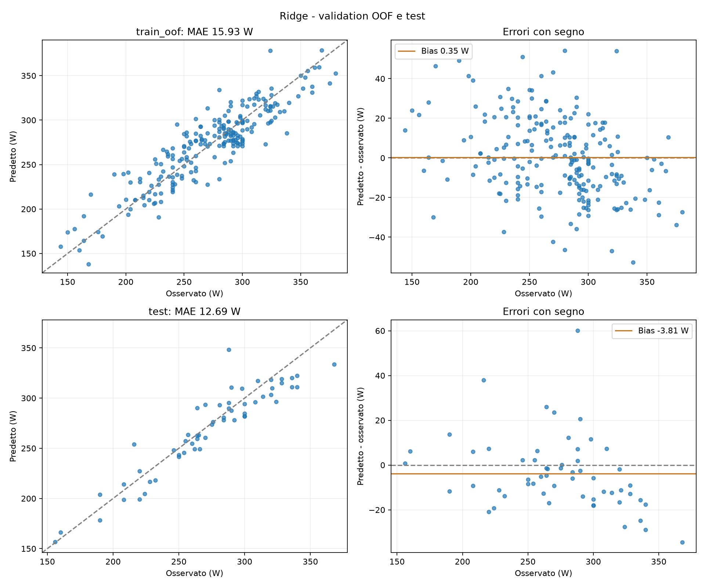
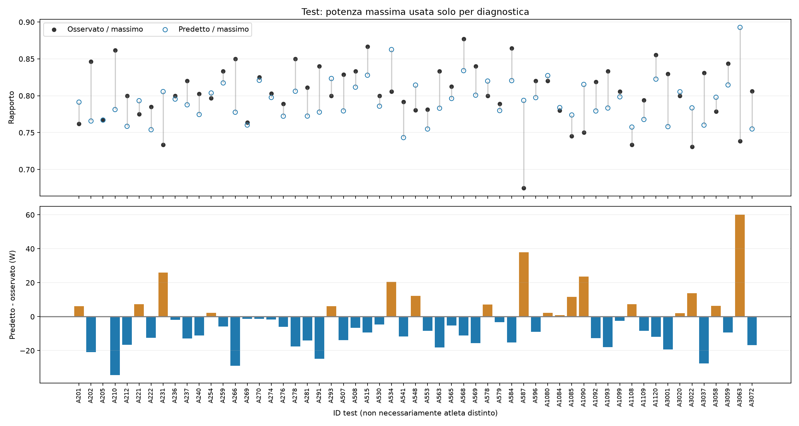
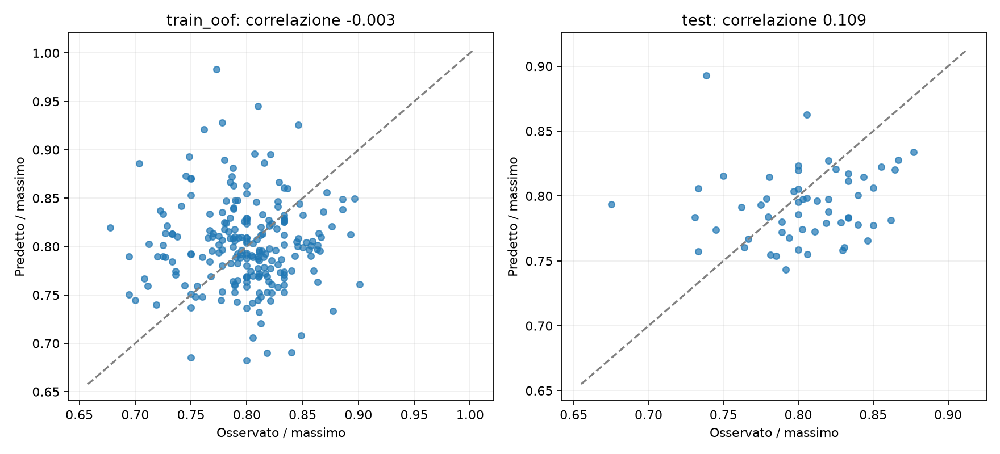

# Ridge: risultati e interpretazione

30 ottobre 2026. Unica run attiva: `results/runs/ridge_final`; unica valutazione attiva: `results/test_ridge`. Prove precedenti e PCA archiviate fuori Git. Nessuna modellizzazione degli scostamenti individuali avviata.

## Procedura

Ridge con imputazione per mediana stratificata per sesso e StandardScaler, 20 covariate originali, senza potenza massima, step, PCA o forward selection. Cinque fold esterni sui 222 record del train QC, quattro interni, dieci alpha. Preprocessing stimato nei fold. Ricerca ripetuta sul train completo: **alpha finale 0,1**. Modello e preprocessing salvati insieme.

Test: 57 record originali, nessuna esclusione o correzione. Verificati hash, ID disgiunti e metriche ricalcolate dalle predizioni. **Il holdout era già stato osservato prima della scelta finale Ridge**: valutazione esplorativa, non nuova conferma indipendente della selezione.

## Prestazioni

| Metrica | Validation OOF (222) | Test (57) | Bootstrap 95% test |
|---|---:|---:|---:|
| MAE (W) | 15,93 | **12,69** | 10,06–15,63 |
| RMSE (W) | 19,89 | **16,57** | 12,63–20,77 |
| R² | 0,810 | **0,867** | 0,751–0,928 |
| Bias predetto − osservato (W) | +0,35 | **−3,81** | — |

MAE medio sui fold 15,94 W, SD 1,09 W. La CV misura la procedura con training parziali, non l'errore del modello rifittato. Il test numericamente migliore può dipendere da composizione, numerosità di fit e variabilità, non dimostra un miglioramento intrinseco.

Bootstrap per riga/test, modello fisso, 2000 campioni, seed 42. Non include selezione o incertezza di training né dipendenza fra test dello stesso atleta. Non sono intervalli individuali; R² non è una percentuale di predizioni corrette.

Errore assoluto test: mediana **11,18 W**, 90° percentile **25,34 W**, massimo **60,16 W**. Entro 10 W: 27/57 (47,4%); entro 20 W: 47/57 (82,5%); entro 30 W: 54/57 (94,7%). Soglie descrittive, non criteri di utilità clinica/sportiva prespecificati. Nessuna predizione negativa.

## Interpretazione

Maggiori coefficienti standardizzati in valore assoluto: potenza a 160 bpm (+47,06 W per SD), massa (+36,81), frequenza cardiaca mediana (+21,93), massa magra (−19,64), VO₂max relativo (+18,86), pliche (−13,41), VO₂ a 160 bpm (−11,59). Intercetta standardizzata 272,64 W.

Sono coefficienti condizionati alle altre variabili, non effetti causali. Massa, massa magra, BMI e composizione corporea sono correlati: segni opposti possono compensarsi. La regolarizzazione non risolve completamente problemi di qualità, collinearità o identificazione.

[Coefficienti e scale](ridge/coefficients.csv) · [Grafico](ridge/coefficients.png). La formula nelle unità originali è verificata equivalente al bundle salvato; per inferenza usare il preprocessing del modello.

## Rapporto con la potenza massima

La massima potenza è usata solo come denominatore diagnostico, mai aggiunta agli input Ridge o usata per ricalibrarlo.

| Statistica | Train OOF | Test |
|---|---:|---:|
| Media osservato/massimo | 0,7989 | 0,8036 |
| Media predetto/massimo | 0,8015 | 0,7927 |
| SD osservato/massimo | 0,0417 | 0,0396 |
| SD predetto/massimo | 0,0452 | 0,0280 |
| Correlazione fra rapporti | −0,0035 | **0,1091** |
| Errore assoluto medio del rapporto | 0,0482 | **0,0369** |

Correlazione potenza predetta/massima: 0,943 sul train OOF e **0,975 sul test**. Nel test la varianza del rapporto predetto è circa metà di quella osservata; nessun rapporto supera uno. Il rapporto predetto medio è 1,09 punti percentuali sotto l'osservato; errore assoluto medio 3,69 punti percentuali della potenza massima.

Ridge rappresenta bene il livello generale di potenza, ma la debole correlazione dei rapporti non mostra una buona ricostruzione delle differenze individuali nella frazione di potenza massima. Il rapporto non è costante per costruzione. La proporzionalità emerge dai dati, non dimostra un meccanismo causale. Anche la validation OOF evidenzia una correlazione dei rapporti pressoché nulla.

## Sovra/sottostima

Test: **19 sovrastime, 38 sottostime**, bias −3,81 W. Train OOF: 105 sovrastime, 117 sottostime, bias +0,35 W. Qui errore = predetto − osservato; nei CSV originali train/evaluate residual_W usa il segno opposto.

| Gruppo test | n | MAE (W) | Bias (W) |
|---|---:|---:|---:|
| F | 11 | 12,32 | −7,59 |
| M | 46 | 12,78 | −2,90 |
| Età <25 | 14 | 15,19 | −15,08 |
| Età 25–34 | 29 | 11,68 | −1,45 |
| Età ≥35 | 13 | 11,89 | +4,14 |
| Età mancante | 1 | 17,56 | −17,56 |
| Target <200 W | 4 | 8,08 | +2,27 |
| Target 200–249 W | 9 | 14,22 | −2,33 |
| Target ≥250 W | 44 | 12,80 | −4,66 |

La sottostima nei più giovani è da verificare: gruppi piccoli, distribuzioni diverse, nessun aggiustamento o conferma statistica. Non attribuire il bias alla sola età. Fasce del target diagnostiche, non fisiologiche.

Errore maggiore A3063: osservato 288 W, predetto 348,16 W (+60,16 W). Seguono A587 (+37,98 W) e A210 (−34,41 W). Nessun caso eliminato per residuo elevato.

## Pro e limiti

Punti favorevoli: modello lineare interpretabile, pipeline riproducibile, CV annidata, errore medio contenuto, nessun input derivato dal lattato e nessuna necessità di PCA/forward selection.

Limiti: venti input, incluse misure da sforzo; 57 test e sottogruppi piccoli; stessa fonte per train/test; atleti non identificabili stabilmente; quattro esclusioni train successive all'esplorazione e non tutte errori confermati. Sette celle mancanti nel test imputate dal train. Collinearità, qualità dei dati ed errori individuali rimangono rilevanti.

La selezione di Ridge segue una lunga esplorazione e la precedente osservazione del holdout. Pur non avendo adattato Ridge direttamente sul test, la valutazione non elimina l'ottimismo da scelte adattive. Non dimostra superiorità generale o validità clinica. T_Lac non è equiparato a IAT, LT1, LT2 o MLSS. Una conferma conclusiva richiederà nuovi dati indipendenti.

Una sola osservazione per ID non consente di stimare varianza intra-individuale. Qui si conservano diagnostiche descrittive; la modellizzazione degli scostamenti individuali è rimandata al prossimo capitolo, senza nuovi modelli o trasformazioni del target.

## Artefatti

[Metriche](../results/metrics.csv) · [Test e bootstrap](../results/test_ridge/summary.json) · [Predizioni e rapporti](ridge/predictions_and_ratios.csv) · [Sottogruppi](ridge/subgroups.csv) · [Statistiche e provenienza](ridge/analysis.json) · [Audit](data_audit.md).
